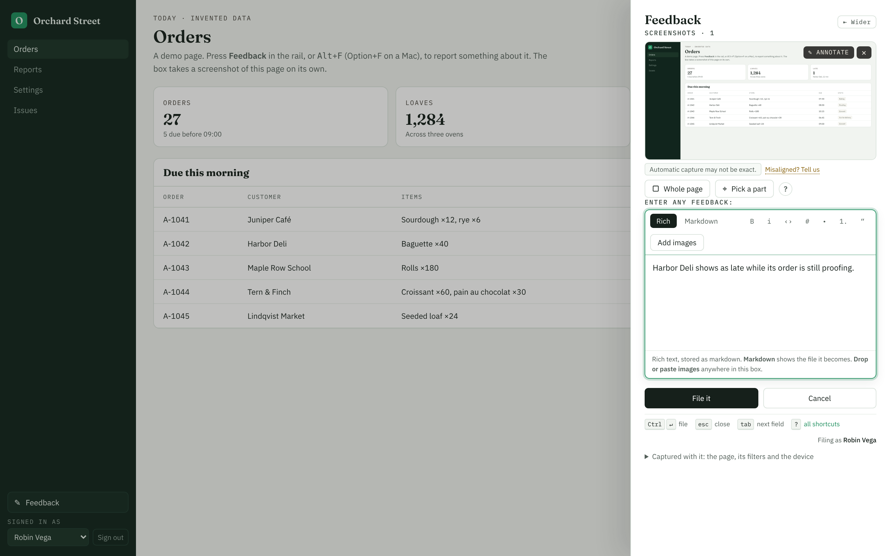
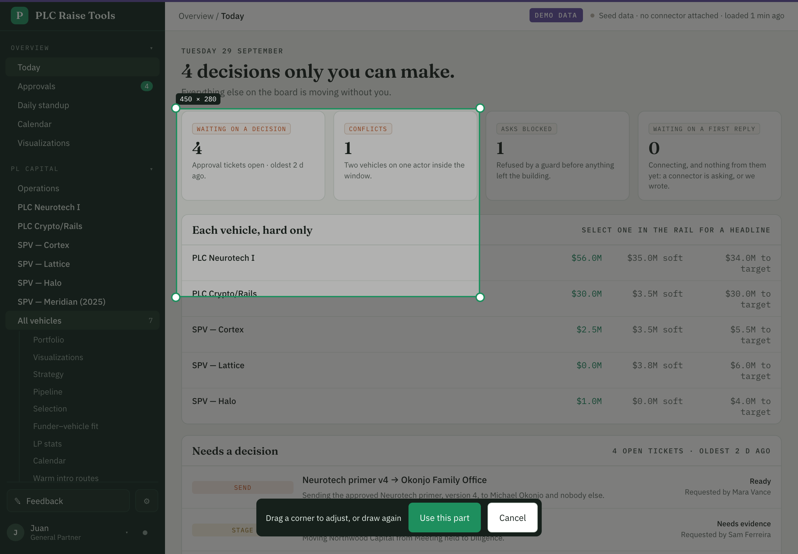
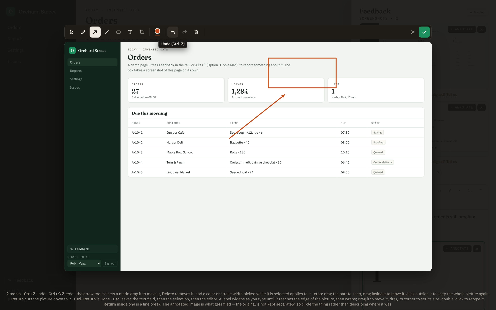
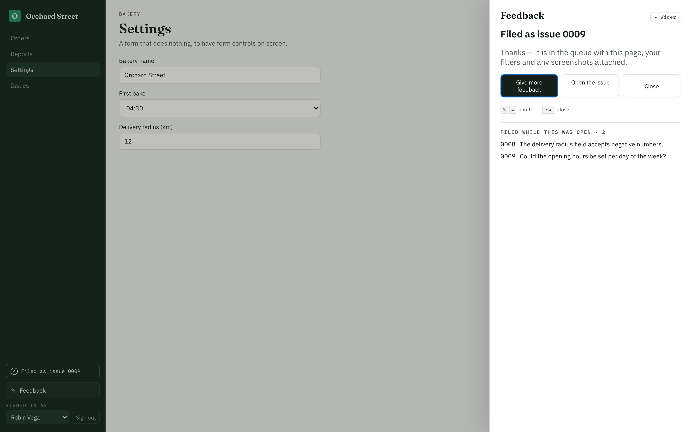
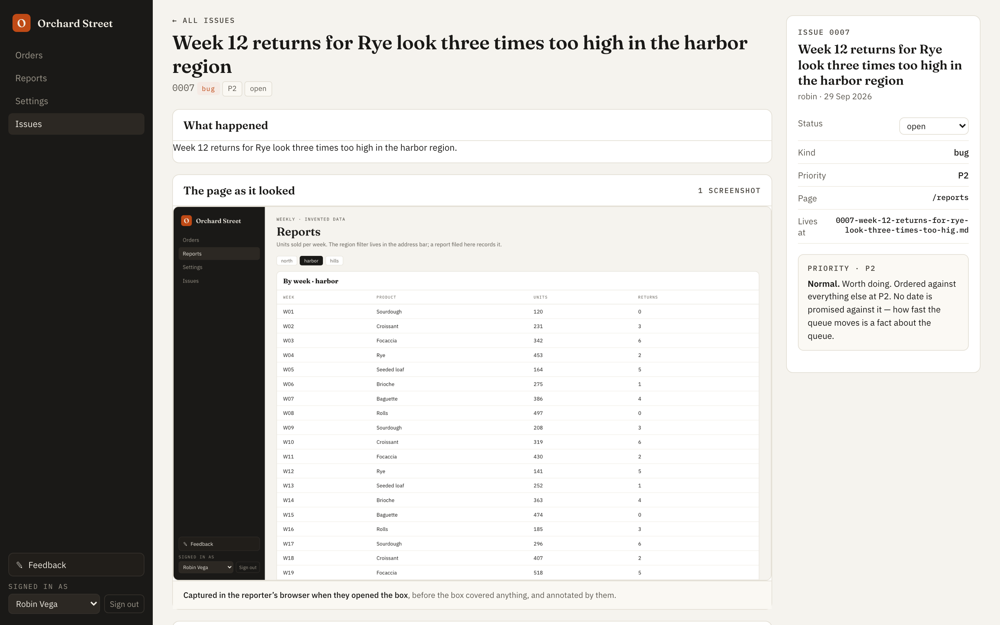
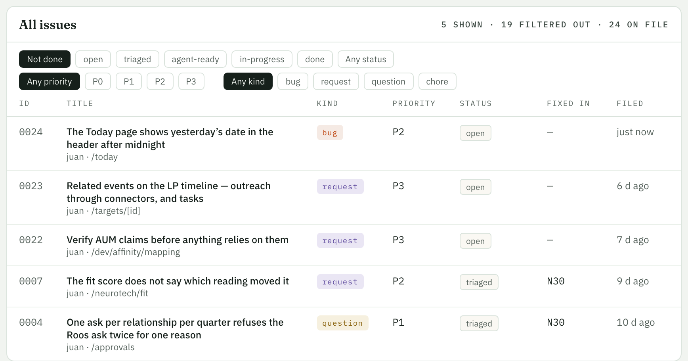

# feedback-kit

An in-app feedback module for React apps, extracted from PL LabOS tools, where it has filed and tracked
every bug report since September 2026. A person presses Alt+F, describes the problem, and files it.
The report arrives with a screenshot of what they were looking at, the page, its filters and the
device. It is saved on the server within milliseconds, even when the app is busy or restarting, and
becomes an issue that a person or a coding agent can pick up.

Two packages:

- **`@jbenet/feedback-react`** (`packages/feedback-react`): the button and shortcut, the feedback
  panel, automatic and exact screenshots, the region picker (mouse and touch), the annotation editor,
  a WYSIWYG markdown field with drag-and-drop and paste of images, per-page drafts, the offline outbox,
  the status line, and the issues pages.
- **`@jbenet/feedback-server`** (`packages/feedback-server`): a journal-first `POST /api/feedback`
  (written to disk before it answers), a background ingester, AI-generated titles, the issues API, and
  stores for files, SQLite/Postgres, and GitHub Issues, and **feedback over MCP** so apps and their
  agents can report problems to each other ([docs/MCP.md](docs/MCP.md)). Next.js and plain Node adapters.

There is no Title field: titles are generated from the body and screenshots on the server.

## Next.js is not required

Neither package depends on Next.js. What each one needs:

- **The client** needs React 19 and a browser. It works in any React app: Vite, Create React App,
  Remix or React Router, Next.js (App or Pages Router), or a plain SPA. Give `FeedbackProvider` the
  current path from whatever router you use, and the issues pages your router's `Link` if you want
  client-side navigation (plain `<a>` links otherwise).
- **The server** needs Node 20 or later, because the journal writes to disk. Its handler takes a
  fetch `Request` and returns a `Response`, so it mounts in anything that speaks that or `node:http`:
  plain Node, Express, Connect, Hono on Node, or Next.js route handlers. The `…/next` and
  `…/node` exports are small adapters on top of it; neither pulls in a framework.
- **Your backend does not have to be JavaScript.** The client only talks HTTP to `/api/feedback` and
  `/api/issues` ([the wire contract](docs/REBUILD.md)). Run the kit's server as a small Node service
  beside your app and proxy those two paths to it, or implement the contract yourself.

Two examples show this: `examples/next-app` (Next.js App Router) and `examples/vite-app` (Vite and
React with no router library, served by `node:http` with no framework).

## Tour

The feedback panel, with the automatic screenshot of the page behind it:



Pick a part of the page, with a mouse or a finger:



Draw on a screenshot to point at the problem:



File it and keep going: the box stays open with the issue number, for the next report:



Each issue keeps the page as it looked, the words and the captured context:



The issues page: counts by priority, velocity, filters and local search (`/`):



More in [docs/FEATURES.md](docs/FEATURES.md).

## Try the examples

`examples/next-app` is a small Next.js app (an invented bakery) wiring both packages, with end-to-end
tests. `examples/vite-app` is the same kit in a Vite + React app on plain Node, in about 150 lines.
From the repository root:

```sh
npm install
npm run dev          # Next.js: builds both packages, then http://localhost:3172: press Alt+F (Option+F on a Mac)
npm run dev:vite     # Vite + node:http, no framework: http://localhost:3173
```

In the Next.js example, pick a person under **Sign in as** in the rail to see the issues pages; filing
works signed out too.

## Quick start without Next.js (Vite, or any React app, on Node)

The whole server is one handler mounted in front of your app. With `node:http`:

```ts
// server.ts
import { createServer } from 'node:http';
import { createFeedbackHandler, fileStore, startIngester } from '@jbenet/feedback-server';
import { toNodeListener } from '@jbenet/feedback-server/node';

const journal = '.data/inbox';
const store = fileStore({ dir: '.data/issues' });
startIngester({ journal, store });
const feedback = createFeedbackHandler({
  journal,
  store,
  resolveReporter: (req) => userFromRequest(req)?.handle ?? null,   // yours, from the session
  authorize: (req) => Boolean(userFromRequest(req)),
});
createServer(toNodeListener(feedback, { fallback: yourApp })).listen(3000);

// Or in Express, before your routes:
// app.use((req, res, next) => toNodeListener(feedback, { fallback: () => next() })(req, res));
```

The client is the provider, the button and the stylesheet:

```tsx
import '@jbenet/feedback-react/styles.css';
import { FeedbackButton, FeedbackProvider, FeedbackStatus, KeyboardShortcuts } from '@jbenet/feedback-react';

export function App() {
  const pathname = useLocation().pathname;   // from your router, or window.location.pathname
  return (
    <FeedbackProvider pathname={pathname}>
      <nav>… <FeedbackStatus /> <FeedbackButton variant="rail" /></nav>
      <main>…</main>
      <KeyboardShortcuts />
    </FeedbackProvider>
  );
}
```

Self-host the fonts and run `VIEWPORT_BOOT` before the first render, as
[`examples/vite-app`](examples/vite-app) does, where the rest (dev server, production build, the
issues pages) is wired up. The Next.js steps below cover the same pieces in more detail.

## Quick start (Next.js App Router)

Each file below is the example's, with its demo sign-in replaced by your session.

```sh
npm install @jbenet/feedback-react @jbenet/feedback-server
# The default theme's fonts, self-hosted (the automatic screenshot can only embed same-origin fonts):
npm install @fontsource/ibm-plex-sans @fontsource/ibm-plex-mono @fontsource-variable/fraunces
```

**1. The server**: one handler, one store and one ingester per process.

```ts
// lib/feedback.ts
import { join, resolve } from 'node:path';
import { createFeedbackHandler, fileStore, startIngester, type FeedbackHandler, type FileStore } from '@jbenet/feedback-server';
import { userFromRequest } from './auth';           // yours: read the session from the cookie, no database

const root = resolve(process.env.FEEDBACK_DATA ?? join(process.cwd(), '.data'));
const journalDir = join(root, 'inbox');              // reports land here first, fsynced
const issuesDir = join(root, 'issues');              // then filed as NNNN-slug.md with their pictures

const g = globalThis as typeof globalThis & { __feedback?: { store: FileStore; handler: FeedbackHandler } };

export function feedback() {
  if (g.__feedback) return g.__feedback;
  const store = fileStore({ dir: issuesDir });
  startIngester({ journal: journalDir, store });    // titles by Claude if ANTHROPIC_API_KEY is set, else the first sentence
  const handler = createFeedbackHandler({
    journal: journalDir,
    store,
    // Who is filing, from your session; never from the request body.
    resolveReporter: (req) => userFromRequest(req)?.handle ?? null,
    // Who may read issues, see their pictures and change their status. Without it, anyone can.
    authorize: (req) => Boolean(userFromRequest(req)),
  });
  return (g.__feedback = { store, handler });
}
```

**2. The routes**: two catch-all files with the same lines.

```ts
// app/api/feedback/[[...path]]/route.ts   (and app/api/issues/[[...path]]/route.ts, exporting GET and PATCH)
import { nextRoutes } from '@jbenet/feedback-server/next';
import { feedback } from '@/lib/feedback';

export const runtime = 'nodejs';
export const dynamic = 'force-dynamic';
export const { GET, POST, PATCH } = nextRoutes({ handle: (req) => feedback().handler.handle(req) });
```

**3. The ingester starts with the server**, so reports a restart left behind are filed:

```ts
// instrumentation.ts
export function register() {
  if (process.env.NEXT_RUNTIME !== 'nodejs' || process.env.NEXT_PHASE === 'phase-production-build') return;
  void import('./lib/feedback').then((m) => { m.feedback(); }).catch(() => undefined);
}
```

```ts
// next.config.ts
export default {
  // Plain Node ESM with optional peers: load it at run time rather than bundle it.
  serverExternalPackages: ['@jbenet/feedback-server', '@anthropic-ai/sdk', 'better-sqlite3', 'pg'],
};
```

**4. The client**: a provider, the button, the status line and the shortcuts dialog.

```tsx
// components/Providers.tsx
'use client';
import { usePathname } from 'next/navigation';
import type { ReactNode } from 'react';
import { FeedbackProvider } from '@jbenet/feedback-react';

export function Providers({ userLabel, children }: { userLabel?: string; children: ReactNode }) {
  return <FeedbackProvider pathname={usePathname()} userLabel={userLabel}>{children}</FeedbackProvider>;
}
```

```tsx
// app/layout.tsx
import '@fontsource-variable/fraunces/opsz.css';
import '@fontsource/ibm-plex-sans/400.css';
import '@fontsource/ibm-plex-sans/500.css';
import '@fontsource/ibm-plex-sans/600.css';
import '@fontsource/ibm-plex-mono/400.css';
import '@fontsource/ibm-plex-mono/500.css';
import '@jbenet/feedback-react/styles.css';
import type { ReactNode } from 'react';
import { FeedbackButton, FeedbackStatus, KeyboardShortcuts, VIEWPORT_BOOT } from '@jbenet/feedback-react';
import { Providers } from '@/components/Providers';

export default function RootLayout({ children }: { children: ReactNode }) {
  return (
    <html lang="en" suppressHydrationWarning>
      <head><script dangerouslySetInnerHTML={{ __html: VIEWPORT_BOOT }} /></head>
      <body>
        <Providers userLabel="…your user's name…">
          <nav>… <FeedbackStatus /> <FeedbackButton variant="rail" /></nav>
          <main>{children}</main>
          <KeyboardShortcuts />
        </Providers>
      </body>
    </html>
  );
}
```

`suppressHydrationWarning` on `<html>` is needed: the kit sets the `--app-h` viewport height on `<html>` before React hydrates.


**5. The issues pages:**

```tsx
// app/issues/page.tsx
'use client';
import Link from 'next/link';
import { IssuesPage } from '@jbenet/feedback-react';
export default function Issues() { return <IssuesPage Link={Link} />; }       // reads GET /api/issues
```

```tsx
// app/issues/[id]/page.tsx
'use client';
import Link from 'next/link';
import { use } from 'react';
import { IssuePage } from '@jbenet/feedback-react';
export default function Issue({ params }: { params: Promise<{ id: string }> }) {
  return <IssuePage id={use(params).id} Link={Link} editable />;               // the status control PATCHes
}
```

(The example's list page reads the store on the server instead and passes `issues` in; either works.)

**6. Let your dev agents in.** With `authorize` set, only signed-in users can read issues, so the
agents that fix them can't. Give them the worker token: generate a long random secret, set it as
`FEEDBACK_WORKER_TOKEN` on the server, and put it in the agents' environment (with the app's host in
their allowed domains). With it they read, and update, issues with no session:

```sh
curl -H "Authorization: Bearer $FEEDBACK_WORKER_TOKEN" "$APP/api/issues?status=open"   # also /api/issues/<id> and its attachments
curl -X PATCH -H "Authorization: Bearer $FEEDBACK_WORKER_TOKEN" -H 'content-type: application/json' \
  -d '{"status":"triaged"}' "$APP/api/issues/0001"
```

The handler logs a hint at startup while issues are locked and no token is set. To have a filing wake
an agent, add `worker` too ([TRIAGE.md §8](docs/TRIAGE.md#one-worker-at-a-time-woken-by-a-filing)).
If your app proxies `/api/feedback` and `/api/issues` to the kit, forward the `Authorization` header.

**Use the kit as it ships.** Copy the client in whole and restyle it only through its CSS variables
and stylesheet. Keep its UX the same: the automatic screenshot, region capture, annotation, drag-drop
and paste of images, drafts and the offline outbox are the point of the kit, so don't rebuild the
drawer or drop parts of it to fit your app.

Also: add the class `nocapture` to anything that must never appear in an automatic screenshot, and
keep `.data/` (or wherever `FEEDBACK_DATA` points) out of git, because reports and screenshots hold
whatever was on screen. Plain Node, Express, SQLite, Postgres and GitHub Issues are in the
[server README](packages/feedback-server/README.md); every client option is in the
[client README](packages/feedback-react/README.md).

## Build and test

```sh
npm run build        # both packages to dist/ (ESM + .d.ts), then the example
npm run typecheck
npm test             # unit tests: the server package, and the client's capture fallbacks
npx playwright install chromium webkit   # once
npm run e2e          # the example's end-to-end tests, in Chromium and WebKit
```

What the suite cannot check headless (the exact screen capture, real Safari) is listed in
[REBUILD.md §15](docs/REBUILD.md#15-what-cannot-be-tested-headless).

## Docs

- [FEATURES.md](docs/FEATURES.md): every feature, with screenshots.
- [REBUILD.md](docs/REBUILD.md): the full specification, precise enough to rebuild the module in any
  React app: components, state machines, the capture pipeline and its pitfalls, the region picker, the
  markdown field, keyboard, the issues pages, accessibility, and acceptance tests.
- [SERVER.md](docs/SERVER.md): the API, the journal, the ingester, the issue file format, the export
  endpoint, security, and the GitHub Issues variant with a comparison.
- [MCP.md](docs/MCP.md): the standard for apps to give each other feedback over MCP: four tools
  (`feedback_submit`, `feedback_status`, `feedback_list`, `feedback_get`), the endpoint, discovery,
  auth, and how to adopt it with or without the kit.
- [TRIAGE.md](docs/TRIAGE.md): how coding agents triage and fix feedback in the background: four
  classes, roles to outcomes, the feedback-fixer pattern.
- [PACKAGES.md](docs/PACKAGES.md): dependencies, versions, and why.
- [CHANGELOG.md](CHANGELOG.md).

Screenshots come from `examples/next-app` and show invented data
(`examples/next-app/scripts/screenshots.mjs` retakes them).

## License

MIT, © Juan Benet. See [LICENSE](LICENSE).
